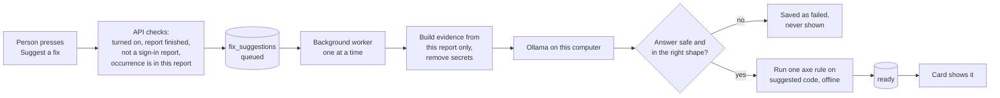

# AI fix suggestions

Axcess can ask a local AI model to suggest a fix for one
[occurrence](./glossary.md#occurrence). This page explains how to turn it on,
what it does with your data, and what it cannot do.

**In short:** it is off unless you turn it on. It runs only on this computer,
through Ollama. It can be wrong, so a person checks every suggestion before
using it. It never changes your site or your report.

## What you see

On a page's details, each occurrence has a **Suggest a fix (AI)** button.
Images get one too, when the scan found a problem with the image. Press it,
and the suggestion waits in a queue, then appears in the same card with:

| Part | What it is |
| --- | --- |
| Summary | One or two sentences on the fix. |
| For developers | Why it is a problem, the element code (HTML) the scan found, the suggested element code, and any CSS. |
| For content editors | Steps to follow in your content system, and text to paste, such as alt text. |
| Rule check result | For some rule check (axe) issues, Axcess runs that one rule on the suggested code. A pass means only that one rule passed. It does not show that the page meets WCAG. |
| Check by hand | Shown when the issue came from a check that needs a person's judgement, or when the model says so. |
| Helpful / Not helpful | Your answer is saved with the suggestion, to help judge the model. |

The view that opens first follows the issue's "Who fixes it": content editors
for text and images, developers for code.

## How it works



- Suggestions run one at a time, in the background. A running scan shares the
  same computer, so it can slow them down.
- The evidence sent to the model comes from one report only: the issue, the
  element code, the text near it, and for some checks the screenshot or image.
  Form values, email addresses, and tokens are removed first.
- Text from the scanned site is marked as data, not instructions. A page that
  says "ignore your rules" cannot change what the model is told to do.
- An answer that contains code that could run (a script, an event handler, a
  `javascript:` link) is refused and never shown.
- The rule check runs in a browser with no network access, on the suggested
  code alone.

## Turn it on

1. Install [Ollama](https://ollama.com) and start it.
2. Install the models. The vision model is optional; without it, image
   suggestions use the text model and do not look at the picture.

   ```bash
   ollama pull qwen2.5-coder:7b-instruct
   ollama pull qwen2.5vl:7b
   ```

3. Update the database: `make migrate`.
4. Set these, then restart Axcess:

| Setting | Default | What it does |
| --- | --- | --- |
| `AUDIT_SUGGESTIONS_ENABLED` | `false` | Turns the feature on. |
| `AUDIT_SUGGESTION_TEXT_MODEL` | `qwen2.5-coder:7b-instruct` | Model for all suggestions. |
| `AUDIT_SUGGESTION_VISION_MODEL` | `qwen2.5vl:7b` | Model used when a picture helps (images, contrast, focus). |
| `AUDIT_SUGGESTION_TIMEOUT_S` | `120` | Longest wait for one answer, 10 to 600 seconds. |
| `AUDIT_SUGGESTION_QUEUE_MAX` | `20` | Most suggestions waiting at once, 1 to 200. |
| `AUDIT_OLLAMA_BASE_URL` | `http://localhost:11434` | Where Ollama is. Keep it on this computer. |

These settings are separate from the models a scan uses, so changing them
never changes a finished report.

## Where it does not work

- **Sign-in reports.** Their evidence is protected and is never sent to a
  model, so there is no button.
- **Unfinished reports.** A running, failed, or stopped scan has no button.
- **Informational issues.** There is nothing to fix.

## What is stored

Each suggestion is saved in the `fix_suggestions` table with the report: the
answer, the models used, the prompt version, the rule check result, and your
Helpful / Not helpful answer. Axcess keeps the last 10 per occurrence.
Deleting a report deletes its suggestions. Suggestions are **not** included
in exports.

## When something goes wrong

| What you see | What to do |
| --- | --- |
| A note that suggestions cannot run | Start Ollama, install the model, or run `make migrate`, as the note says. |
| "The AI model took too long to answer" | Try again when no scan is running, or raise `AUDIT_SUGGESTION_TIMEOUT_S`. |
| "An answer Axcess could not use safely" | Press **Try again**. If it keeps happening, try another model. |
| "Axcess restarted before the suggestion was finished" | Press **Try again**. |

## Measuring the model

`make suggest-eval` runs the prompt on a small set of made-up cases
(`tests/quality/suggest/cases_v1.yaml`) with your local model and prints how
many answers were usable and how many passed the rule check. It fails if any
answer contained code that could run. Run it after changing the prompt
(`src/audit/suggest/prompts/`) or the model.

## For developers

The code is in `src/audit/suggest/`:

| File | Job |
| --- | --- |
| `service.py` | Request rules and refusals; called by thin routes in `web/server.py`. |
| `context.py` | Builds the evidence from one report and removes secrets. |
| `provider.py` | Prompt, Ollama calls, and the answer's safety check. |
| `verify.py` | Runs one axe rule on the suggested code, offline. |
| `queue.py` | The background worker. |
| `repo.py` | SQL for `fix_suggestions` (migration `0030`). |

The API is `GET /api/suggestions/status`, `POST /api/scans/{id}/suggestions`,
`GET /api/scans/{id}/suggestions/{sid}`,
`GET /api/scans/{id}/occurrences/{kind}/{oid}/suggestion`, and `POST` to
`.../{sid}/cancel` and `.../{sid}/feedback`. Tests are in
`tests/ui/test_fix_suggestions.py` and `tests/ui/test_fix_suggestion_ui.py`.
