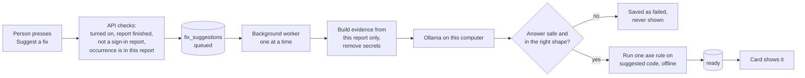

# AI fix suggestions

Axcess can ask a local AI model to suggest a fix for one
[occurrence](./glossary.md#occurrence). This page explains how to turn it on,
what it does with your data, and what it cannot do.

**In short:** it is off unless you turn it on. It runs only on this computer,
through Ollama. It can be wrong, so a person checks every suggestion before
using it. It never changes your site or your report.

## What you see

On a page's details, each occurrence has a **Suggest a fix (AI)** button.
Images get one too, when the scan found a problem with the image. Press it,
and the suggestion waits in a queue, then appears in the same card.

The Page inspector has the same button. It is in its own row under the
saved copy's toolbar, below the facts about the flagged element you are on.
Move to another element with Previous or Next, and the row shows that
element's suggestion.

Each suggestion sits in its own tinted box with a thick left border, so it
is never mistaken for what the scan found. It is brief on purpose:

| Part | What it is |
| --- | --- |
| For developers | **Before**: the element code (HTML) the scan found. For an image, Axcess reads it from the saved copy of the page. If the scan kept no element code (for example, a check of the whole page), "Before" says so. **After**: the suggested element code, and any CSS. When there is no code, a short explanation instead. |
| For content editors | Short steps to follow in your content system, and text to paste, such as alt text. Text already in a step is not repeated. |
| Rule check result | Shown only when it ran. For some rule check (axe) issues, Axcess runs that one rule on the suggested code. A pass means only that one rule passed. It does not show that the page meets WCAG. |
| About this suggestion | Closed by default. What to check by hand, whether a rule check could run, which model wrote it and when, and that it is not included in exports. |
| Helpful / Not helpful | Your answer is saved with the suggestion, to help judge the model. |

The warning "It can be wrong. Check it before you use it." is always shown.

The view that opens first follows the issue's "Who fixes it": content editors
for text and images, developers for code.

## How it works



- Suggestions run one at a time, in the background. A running scan shares the
  same computer, so it can slow them down.
- The evidence sent to the model comes from one report only: the issue, the
  element code, the text near it, and for some checks the screenshot or image.
  Form values, email addresses, and tokens are removed first.
- Text from the scanned site is marked as data, not instructions. A page that
  says "ignore your rules" cannot change what the model is told to do.
- An answer that contains code that could run (a script, an event handler, a
  `javascript:` link) is refused and never shown.
- The rule check runs in a browser with no network access, on the suggested
  code alone.

## Set up AI features in the desktop app

**Settings > AI features** installs everything the AI features need, after
you ask it to. Nothing is downloaded before that. On a fresh installation,
Axcess offers **Set up AI features** or **Continue without AI** when it first
opens. Choosing setup opens the size page; it does not start a download.
Choosing to continue keeps AI off. You can change your choice in Settings.

1. Axcess checks this computer: memory (RAM), free disk space, and whether
   there is a graphics chip that speeds AI up (an Apple chip, or an NVIDIA or
   AMD card).
2. It suggests a size. You can pick another one.

   | Size | Needs at least | Text model | Image model | Download |
   | --- | --- | --- | --- | --- |
   | Small | 8 GB memory | `qwen3:4b-instruct-2507-q4_K_M` | `qwen3-vl:2b-instruct` | about 4.4 GB |
   | Standard | 16 GB memory | `qwen2.5-coder:7b-instruct` | `qwen3-vl:4b-instruct` | about 8 GB |
   | Large | 32 GB memory | `qwen2.5-coder:14b-instruct` | `qwen3-vl:8b-instruct` | about 15 GB |

   Without a graphics chip Axcess suggests Small, because larger models are
   very slow on the processor alone. All models use the Apache 2.0 licence.
3. Select **Download and set up**. If Ollama is already running on this computer
   (port 11434), Axcess uses it and adds the models there. If not, Axcess
   downloads Ollama 0.33.0 (MIT licence) from its GitHub release, checks the
   file against a fixed SHA-256 checksum, and runs its own copy on a private
   port that only this computer can reach.
4. You can select **Pause download** and **Resume download** later. A
   download that stops part way picks up where it stopped. Axcess does not
   start the download if the disk does not have room for what is left, plus 3 GB.

When it finishes, AI fix suggestions use the new models. The AI checks during
a scan are still off for each new scan; turn them on in the scan form if you
want them.

Files are kept in the Axcess data folder, under `ai/`: the Ollama program in
`ai/runtime`, models in `ai/models`, and the setup in `ai/config.json`.
The on/off and first-launch choices are saved in `ai/preferences.json`.
**Remove AI features** deletes Axcess's program and models and forgets the
setup. It keeps the saved off choice so the welcome does not repeat.
If Axcess used an Ollama you already had,
removing only forgets the setup; the models stay in your Ollama.

### Turn AI off without removing it

Select **Turn AI off** in **Settings > AI features**. This stops Axcess's
private Ollama and blocks new AI suggestions and model-based scan checks.
It does not stop an Ollama you started yourself. Models are kept, and the
choice stays saved when you close and reopen Axcess.

Regular checks, reading text inside images (OCR), reports, exports and saved
AI suggestions still work. The motion check keeps its regular browser checks
but does not ask an AI model.

Finish or stop a scan, finish or cancel waiting AI answers, and pause a
download before changing the setting. Canceling an answer can leave its model
request finishing in the background; wait for that request to finish too.
Axcess explains why it cannot change the setting and leaves the choice as it
was. It does not switch off later without another click.

Select **Turn AI on** to reuse the kept models. If there is no setup yet,
choose a size and select **Download and set up** instead. AI becomes available
only when the required local models are ready. Scan-time AI checks are still
off for each new scan until you choose them. Existing installations keep
their setup and do not repeat the first-launch choice.

Sizes, checksums, and model names are pinned in `src/audit/ai/catalog.json`.
To move to a newer Ollama or model, update that file in a release.

## Turn it on

**In the desktop app**, choose AI during first launch or open
**Settings > AI features** (see
[Set up AI features in the desktop app](#set-up-ai-features-in-the-desktop-app)).
You can also do steps 1 and 2 yourself, then enable AI in Settings. Until the models are there, the
button's place shows what is missing and links to the setup page. Axcess
never downloads anything until you choose a size and select **Download and
set up**.
To turn AI off, use **Turn AI off** in Settings. The saved desktop choice
takes precedence over `AUDIT_SUGGESTIONS_ENABLED`.

**In the web version** follow all four steps.

1. Install [Ollama](https://ollama.com) and start it.
2. Install the models. The vision model is optional; without it, image
   suggestions use the text model and do not look at the picture.

   ```bash
   ollama pull qwen2.5-coder:7b-instruct
   ollama pull qwen2.5vl:7b
   ```

3. Update the database: `make migrate`.
4. Set these, then restart Axcess:

| Setting | Default | What it does |
| --- | --- | --- |
| `AUDIT_SUGGESTIONS_ENABLED` | `false` (`true` in the desktop app) | Turns the feature on. |
| `AUDIT_SUGGESTION_TEXT_MODEL` | `qwen2.5-coder:7b-instruct` | Model for all suggestions. |
| `AUDIT_SUGGESTION_VISION_MODEL` | `qwen2.5vl:7b` | Model used when a picture helps (images, contrast, focus). |
| `AUDIT_SUGGESTION_TIMEOUT_S` | `120` | Longest wait for one answer, 10 to 600 seconds. |
| `AUDIT_SUGGESTION_QUEUE_MAX` | `20` | Most suggestions waiting at once, 1 to 200. |
| `AUDIT_OLLAMA_BASE_URL` | `http://localhost:11434` | Where Ollama is. Keep it on this computer. |

Axcess asks Ollama for the exact answer shape it checks (structured
output), caps the answer's length, and keeps the model loaded for 10
minutes after the last suggestion so the next one starts faster. Then
Ollama frees the memory.

These settings are separate from the models a scan uses, so changing them
never changes a finished report.

## Where it does not work

- **Sign-in reports.** Their evidence is protected and is never sent to a
  model, so there is no button.
- **Unfinished reports.** A running, failed, or stopped scan has no button.
- **Informational issues.** There is nothing to fix.

## What is stored

Each suggestion is saved in the `fix_suggestions` table with the report: the
answer, the models used, the prompt version, the rule check result, and your
Helpful / Not helpful answer. Axcess keeps the last 10 per occurrence.
Deleting a report deletes its suggestions. Suggestions are **not** included
in exports.

## When something goes wrong

| What you see | What to do |
| --- | --- |
| A note that suggestions cannot run | Start Ollama, install the model, or run `make migrate`, as the note says. |
| "The AI model took too long to answer" | Try again when no scan is running, or raise `AUDIT_SUGGESTION_TIMEOUT_S`. |
| "An answer Axcess could not use safely" | Press **Try again**. If it keeps happening, try another model. |
| "Axcess restarted before the suggestion was finished" | Press **Try again**. |

## Measuring the model

`make suggest-eval` runs the prompt on a small set of made-up cases
(`tests/quality/suggest/cases_v1.yaml`) with your local model and prints how
many answers were usable and how many passed the rule check. It fails if any
answer contained code that could run. Run it after changing the prompt
(`src/audit/suggest/prompts/`) or the model.

## For developers

The code is in `src/audit/suggest/`:

| File | Job |
| --- | --- |
| `service.py` | Request rules and refusals; called by thin routes in `web/server.py`. |
| `context.py` | Builds the evidence from one report and removes secrets. |
| `provider.py` | Prompt, Ollama calls, and the answer's safety check. |
| `verify.py` | Runs one axe rule on the suggested code, offline. |
| `queue.py` | The background worker. |
| `repo.py` | SQL for `fix_suggestions` (migration `0030`). |

The API is `GET /api/suggestions/status`, `POST /api/scans/{id}/suggestions`,
`GET /api/scans/{id}/suggestions/{sid}`,
`GET /api/scans/{id}/occurrences/{kind}/{oid}/suggestion`, and `POST` to
`.../{sid}/cancel` and `.../{sid}/feedback`. Tests are in
`tests/ui/test_fix_suggestions.py` and `tests/ui/test_fix_suggestion_ui.py`.
