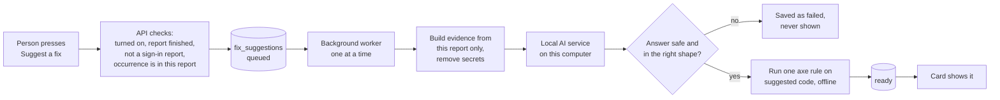

# AI fix suggestions

Axcess can ask a local AI model to suggest a fix for one
[occurrence](./glossary.md#occurrence). This page explains how to turn it on,
what it does with your data, and what it cannot do.

**In short:** it is off unless you turn it on. It runs only on this computer:
in the desktop app, through its own private AI service; in the web version,
through an Ollama or llama.cpp server that you run. It can be wrong, so a
person checks every suggestion before using it. It never changes your site or
your report.

## What you see

On a page's details, each occurrence has a **Suggest a fix (AI)** button.
Images get one too, when the scan found a problem with the image. Press it,
and the suggestion waits in a queue, then appears in the same card.

The Page inspector has the same button. It is in its own row under the
saved copy's toolbar, below the facts about the flagged element you are on.
Move to another element with Previous or Next, and the row shows that
element's suggestion.

Each suggestion sits in its own tinted box with a thick left border, so it
is never mistaken for what the scan found. It is brief on purpose:

| Part | What it is |
| --- | --- |
| For developers | **Before**: the element code (HTML) the scan found. For an image, Axcess reads it from the saved copy of the page. If the scan kept no element code (for example, a check of the whole page), "Before" says so. **One change sentence**, then **Option 1: Smallest change** and **Option 2: Matches nearby code**, each with **After** code and any needed styles (CSS). Both use only page code saved by the scan, not a source repository. Older saved suggestions keep their single After view. |
| Guidance | A link to the rule guidance, only when the scan saved one. The AI never writes this link. |
| For content editors | Short steps to follow in your content system, and text to paste, such as alt text. Text already in a step is not repeated. |
| Rule check result | Each new code option has a separate result, including when Axcess could not check it. For some rule check (axe) issues, Axcess runs that one rule on the suggested code. A pass means only that one rule passed. It does not show that the page meets WCAG. |
| About this suggestion | Closed by default. What to check by hand, whether a rule check could run, which model wrote it and when, and that it is not included in exports. |
| Helpful / Not helpful | Your answer is saved with the suggestion, to help judge the model. |

The warning "Written by AI on this computer. It can be wrong. Check it before you use it." is always shown. What to check by hand stays in **About this suggestion**.

While an answer is being written, a short status says you can keep browsing other issues.

The view that opens first follows the issue's "Who fixes it": content editors
for text and images, developers for code.

### Answer format (developer notes)

New model answers use `version: 2`. `developer.change_sentence` is one sentence,
up to 25 words and 240 characters. `developer.options` contains exactly two
objects, in this order:

```json
[
  {"kind": "minimal", "label": "Smallest change", "after_html": "...", "css": null},
  {"kind": "matches_pattern", "label": "Matches nearby code", "after_html": "...", "css": null}
]
```

Each code field is limited to 4,000 characters. Each label has at most 60.
The editor fields, AI warning, and manual-check note stay available.
Axcess adds `check_outcome` to each option after its own offline check.
It adds `before_html` from saved evidence and `help_url` from the same report's
saved rule, allowing only HTTP or HTTPS links. Neither comes from the model.
The existing answer JSON column stores these fields; no new table is needed.
Saved version 1 answers, including those without a version field, still open
in their original view. New model answers must use version 2.

## How it works



- Suggestions run one at a time, in the background. A running scan shares the
  same computer, so it can slow them down.
- The evidence sent to the model comes from one report only: the issue, the
  element code, the text near it, and for some checks the screenshot or image.
  Form values, email addresses, and tokens are removed first.
- Text from the scanned site is marked as data, not instructions. A page that
  says "ignore your rules" cannot change what the model is told to do.
- An answer that contains code that could run (a script, an event handler, a
  `javascript:` link) is refused and never shown.
- The rule check runs in a browser with no network access, on the suggested
  code alone.

## Set up AI features in the desktop app

**Settings > AI features** downloads what the AI features need, after you
ask it to. Nothing is downloaded before that. On a fresh installation,
Axcess offers **Set up AI features** or **Continue without AI** when it first
opens. Choosing setup opens the size page; it does not start a download.
Choosing to continue keeps AI off. You can change your choice in Settings.

1. Axcess checks this computer: memory (RAM), free disk space, and whether
   there is a graphics chip that speeds AI up (an Apple chip, or an NVIDIA or
   AMD card).
2. It suggests a size. You can pick another one.

   | Size | Needs at least | Text model | Image model | Download |
   | --- | --- | --- | --- | --- |
   | Small | 8 GB memory | `qwen3:4b-instruct-2507-q4_K_M` | `qwen3-vl:2b-instruct` | about 4.4 GB |
   | Standard | 16 GB memory | `qwen2.5-coder:7b-instruct` | `qwen3-vl:4b-instruct` | about 8 GB |
   | Large | 32 GB memory | `qwen2.5-coder:14b-instruct` | `qwen3-vl:8b-instruct` | about 15 GB |

   Without a graphics chip Axcess suggests Small, because larger models are
   very slow on the processor alone. All models use the Apache 2.0 licence.
3. Select **Download and set up** after checking the size shown on the button.
   Axcess downloads only the AI models for that size, as GGUF files, from
   Hugging Face, a website that shares AI models. Each file is pinned to an
   exact version. Axcess checks each file against its SHA-256 checksum
   before it uses it.
   The desktop app already includes the AI program (llama.cpp, MIT licence),
   so it is not downloaded. When you run Axcess from source code, setup also
   downloads the same pinned AI program from GitHub and checks it the same
   way. The setup page shows the program's build number and licence.
4. You can select **Pause download** and **Resume download** later. A
   download that stops part way picks up where it stopped. Axcess does not
   start the download if the disk does not have room for what is left, plus 3 GB.

When it finishes, AI fix suggestions use the new models. The AI checks during
a scan are still off for each new scan; turn them on in the scan form if you
want them.

Files are kept in the Axcess data folder, under `ai/`:

| File or folder | What it holds |
| --- | --- |
| `ai/gguf` | The AI models, and any model download that stopped part way. |
| `ai/runtime` | The AI program (llama.cpp), only when you run Axcess from source code. The desktop app keeps its own copy inside the app. |
| `ai/downloads` | An AI program download that stopped part way (only when you run Axcess from source code). |
| `ai/scratch` | The private connection to the AI service (a UNIX socket file), and the service's working files. |
| `ai/llama-server.log` | What the private AI service wrote while it started and ran. |
| `ai/config.json` | The setup: the size and the models. |
| `ai/preferences.json` | The on/off and first-launch choices. |

**Remove AI features** stops the private AI service, deletes the AI files
Axcess downloaded, and forgets the setup. It keeps the saved off choice so
the welcome does not repeat.
An older version of Axcess could also use an Ollama you already had. For a
setup saved that way, removing only forgets the setup; the models stay in
your Ollama.

### A setup from an older version

Older versions of the desktop app ran the models in a private copy of
Ollama. That setup no longer runs. Choose a size and select **Download and
set up** to download the models again. When that download finishes, Axcess
deletes the old private Ollama files from its data folder. It never touches
an Ollama you installed yourself.

### Turn AI off without removing it

Select **Turn AI off** in **Settings > AI features**. This stops the private
AI service and blocks new AI suggestions and model-based scan checks.
It does not stop an Ollama you started yourself. Models are kept, and the
choice stays saved when you close and reopen Axcess.

Regular checks, reading text inside images (OCR), reports, exports and saved
AI suggestions still work. The motion check keeps its regular browser checks
but does not ask an AI model.

Finish or stop a scan, finish or cancel waiting AI answers, and pause a
download before changing the setting. Canceling an answer can leave its model
request finishing in the background; wait for that request to finish too.
Axcess explains why it cannot change the setting and leaves the choice as it
was. It does not switch off later without another click.

Select **Turn AI on** to reuse the kept models. This starts the private AI
service again. If there is no setup yet,
choose a size and select **Download and set up** instead. AI becomes available
only when the required local models are ready. Scan-time AI checks are still
off for each new scan until you choose them. Existing installations keep
their setup and do not repeat the first-launch choice.

### Start the private AI service

When AI is on, Axcess starts the private AI service by itself: when you turn
AI on, and in the background when the app opens. Until the service is ready,
AI requests say that it is not running. To start it yourself, select
**Start AI service** in Settings or AI features. This starts only Axcess's
own service and never downloads anything. It does not start, stop or
download into your own Ollama.

### How the private AI service is kept away from the internet

The private AI service runs inside an operating-system sandbox that has no
internet access.

| System | What happens |
| --- | --- |
| Linux | Bubblewrap (`bwrap`) runs the service with no network. Bubblewrap must be installed. Without it, AI does not start. |
| macOS | A deny-by-default `sandbox-exec` profile allows only the AI program, the models, a scratch folder, the system libraries, the Mac graphics driver (Metal), and the Python needed for the isolation check. Networking is limited to this computer (loopback). |
| Windows | The private AI service cannot be isolated yet, so AI does not start. Saved results still work. |

- Axcess talks to the service through a private connection: a UNIX socket
  file in `ai/scratch`, in its data folder.
- Before startup, an isolation check runs in the same sandbox. The operating
  system must refuse a test connection to the internet. A timeout does not
  count. If the check fails, AI stays stopped; report browsing and saved
  suggestions still work.
- Axcess never falls back to running the service without the sandbox.
- A connection file left from an earlier run is not trusted. Axcess sends no
  model requests to it until the service it started has passed the isolation
  check.
- The AI program also runs with its offline setting, but the operating
  system's sandbox, not that setting, is what blocks the internet.
- Axcess tries the graphics chip build first: Metal on Apple Silicon Macs,
  Vulkan on Linux and Windows. If that build cannot load the models, it uses
  the processor-only (CPU) build. There are no NVIDIA CUDA or AMD ROCm builds.
- The bundled AI program, its sandbox and graphics chip use still need
  testing in a packaged desktop release, and the macOS sandbox on a real Mac.

Each file is pinned in `src/audit/ai/catalog.json`: the AI program by its
build and SHA-256, and each model file by its Hugging Face repository,
commit, size and SHA-256. A file that does not match is deleted and never
used. Downloads happen on this computer only after the size-labelled
confirmation button, never inside the private AI service. No report evidence
is sent to Hugging Face or GitHub.

## Turn it on

**In the desktop app**, choose AI during first launch or open
**Settings > AI features** (see
[Set up AI features in the desktop app](#set-up-ai-features-in-the-desktop-app)).
The desktop app uses its own private AI service, never an Ollama it finds on
this computer. Until the private models are there, the
button's place shows what is missing and links to the setup page. Axcess
never downloads anything until you choose a size and select **Download and
set up**.
To turn AI off, use **Turn AI off** in Settings. The saved desktop choice
takes precedence over `AUDIT_SUGGESTIONS_ENABLED`.

**In the web version** (run from source code, or hosted), you run the AI
service yourself. Follow all four steps.

1. Install [Ollama](https://ollama.com) and start it. To use a llama.cpp
   server instead, set `AUDIT_MODEL_BACKEND=llama_cpp` and its address in
   `AUDIT_LLAMA_CPP_URL`, or its UNIX socket file in `AUDIT_LLAMA_CPP_SOCKET`.
   Then load the models there instead of step 2.
2. Install the models. The vision model is optional; without it, image
   suggestions use the text model and do not look at the picture.

   ```bash
   ollama pull qwen2.5-coder:7b-instruct
   ollama pull qwen2.5vl:7b
   ```

3. Update the database: `make migrate`.
4. Set these, then restart Axcess:

| Setting | Default | What it does |
| --- | --- | --- |
| `AUDIT_SUGGESTIONS_ENABLED` | `false` (`true` in the desktop app) | Turns the feature on. |
| `AUDIT_SUGGESTION_TEXT_MODEL` | `qwen2.5-coder:7b-instruct` | Model for all suggestions. |
| `AUDIT_SUGGESTION_VISION_MODEL` | `qwen2.5vl:7b` | Model used when a picture helps (images, contrast, focus). |
| `AUDIT_SUGGESTION_TIMEOUT_S` | `120` | Longest wait for one answer, 10 to 600 seconds. |
| `AUDIT_SUGGESTION_QUEUE_MAX` | `20` | Most suggestions waiting at once, 1 to 200. |
| `AUDIT_OLLAMA_BASE_URL` | `http://localhost:11434` | Where Ollama is. Keep it on this computer. |

With Ollama, Axcess asks for the exact answer shape it checks (structured
output), caps the answer's length, and keeps the model loaded for 10
minutes after the last suggestion so the next one starts faster. Then
Ollama frees the memory.

These settings are separate from the models a scan uses, so changing them
never changes a finished report.

## Where it does not work

- **Sign-in reports.** Their evidence is protected and is never sent to a
  model, so there is no button.
- **Unfinished reports.** A running, failed, or stopped scan has no button.
- **Informational issues.** There is nothing to fix.

## What is stored

Each suggestion is saved in the `fix_suggestions` table with the report: the
answer, the models used, the prompt version, the rule check result, and your
Helpful / Not helpful answer. Axcess keeps the last 10 per occurrence.
Deleting a report deletes its suggestions. Suggestions are **not** included
in exports.

## When something goes wrong

| What you see | What to do |
| --- | --- |
| A note that suggestions cannot run | Do what the note says: in the desktop app, start the private AI service or download the models in **Settings > AI features**; in the web version, start Ollama, install the model, or run `make migrate`. |
| "The AI model took too long to answer" | Try again when no scan is running, or raise `AUDIT_SUGGESTION_TIMEOUT_S`. |
| "An answer Axcess could not show safely" or "did not suggest a real change" | Axcess already asked the model a second time, explaining what was wrong. Pressing **Try again** usually gives the same answer, so choose a bigger model in Settings, or fix it by hand with the rule guidance. |
| "Axcess restarted before the suggestion was finished" | Press **Try again**. |

## Measuring the model

`make suggest-eval` runs the prompt on a small set of made-up cases
(`tests/quality/suggest/cases_v1.yaml`) with your local model and prints how
many answers were usable and how many passed the rule check. It fails if any
answer contained code that could run. Run it after changing the prompt
(`src/audit/suggest/prompts/`) or the model.

## For developers

The code is in `src/audit/suggest/`:

| File | Job |
| --- | --- |
| `service.py` | Request rules and refusals; called by thin routes in `web/server.py`. |
| `context.py` | Builds the evidence from one report and removes secrets. |
| `provider.py` | Prompt, model calls, and the answer's safety check. |
| `verify.py` | Runs one axe rule on the suggested code, offline. |
| `queue.py` | The background worker. |
| `repo.py` | SQL for `fix_suggestions` (migration `0030`). |

The API is `GET /api/suggestions/status`, `POST /api/scans/{id}/suggestions`,
`GET /api/scans/{id}/suggestions/{sid}`,
`GET /api/scans/{id}/occurrences/{kind}/{oid}/suggestion`, and `POST` to
`.../{sid}/cancel` and `.../{sid}/feedback`. Tests are in
`tests/ui/test_fix_suggestions.py` and `tests/ui/test_fix_suggestion_ui.py`.
