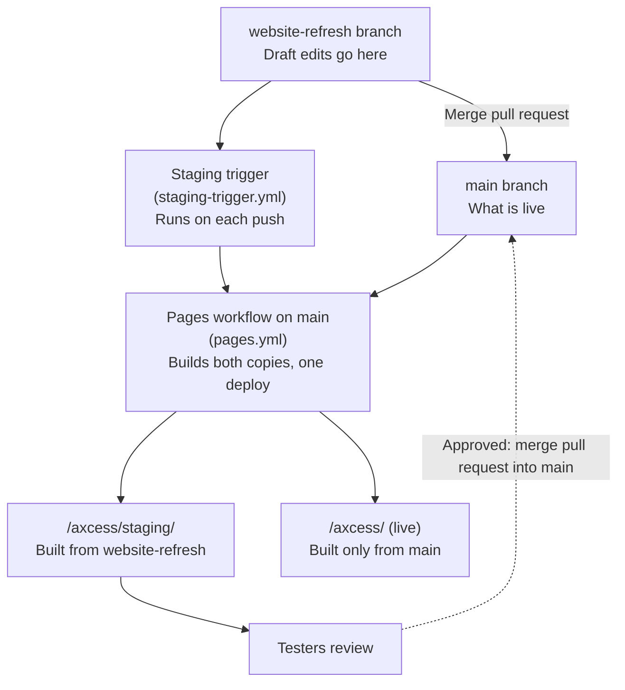

# The Axcess public site

This folder holds the public site: the product pages and the user guides,
built as static HTML by Astro and Starlight. The guides come straight from
`docs/`, so nothing is copied. This file is not published; Astro only
publishes pages under `src/pages` and the guides.

## Where the site is published

There are two copies. Each one is built from its own branch.

| Branch | Address | Who it is for |
| --- | --- | --- |
| `main` | <https://lsa-mis.github.io/axcess/> | Everyone. This is the live site. |
| `website-refresh` (the staging branch) | <https://lsa-mis.github.io/axcess/staging/> | Testers. A draft shared for feedback. |

The staging copy has a notice at the top of every page that says it is a
draft, with a link to the live site. It also asks search engines not to list
it (`noindex`).

## How a change reaches each copy



The same steps in words:

1. Make site changes on the staging branch, `website-refresh`, and push.
2. The push starts the staging trigger (`.github/workflows/staging-trigger.yml`).
   It cannot publish by itself, so it asks the Pages workflow on `main` to run.
3. The Pages workflow (`.github/workflows/pages.yml` on `main`) builds two
   copies in one run:
   - the live copy, from `main`, published at `/axcess/`;
   - the staging copy, from `website-refresh`, published at `/axcess/staging/`.
4. Testers review the staging copy and send feedback.
5. When the change is approved, open a pull request from `website-refresh`
   into `main` and merge it. The next run publishes it on the live site.

A push to `main` also starts the Pages workflow, which publishes both
copies again.

## Why both copies are built in one run

GitHub Pages replaces the whole site on every deploy. Also, only `main` is
allowed to deploy (the `github-pages` environment rule). So a staging update
cannot publish only `/staging/`. Each run rebuilds the live copy from `main`
and adds the staging copy beside it.

## How the live site is kept safe

- The live copy is built only from `main`. The staging branch never changes
  what it contains.
- The staging copy goes only under `staging/`. Before it publishes anything,
  the workflow compares the final site with the live copy, byte for byte. It
  stops the deploy if any live file changed, or if the live copy already has
  a `staging/` folder.
- If the staging copy fails to build or fails its tests, that run publishes
  the live copy without it. A broken draft never blocks or changes the live
  site.

## Build a copy on your computer

The live copy, served under `/axcess/`:

```bash
make site
uv run pytest tests/public_site
```

The staging copy, served under `/axcess/staging/`, with the draft notice:

```bash
AXCESS_SITE_BASE=/axcess/staging AXCESS_SITE_STAGING=1 make site
AXCESS_SITE_BASE=/axcess/staging AXCESS_SITE_STAGING=1 uv run pytest tests/public_site
```

Use the same two settings for both commands, so the tests check the copy you
built.

| Setting | What it does | Default |
| --- | --- | --- |
| `AXCESS_SITE_BASE` | The path the site is served under. | `/axcess` |
| `AXCESS_SITE_STAGING` | `1` adds the draft notice and `noindex` to every page. | not set |

## Use a different staging branch

1. In `main`'s `.github/workflows/pages.yml`, change `STAGING_BRANCH`.
2. On the new branch, add `.github/workflows/staging-trigger.yml` and set the
   branch name under `on.push.branches`.

If the staging branch is deleted, the Pages workflow publishes the live copy
alone, and `/axcess/staging/` stops working until a staging branch exists
again.
